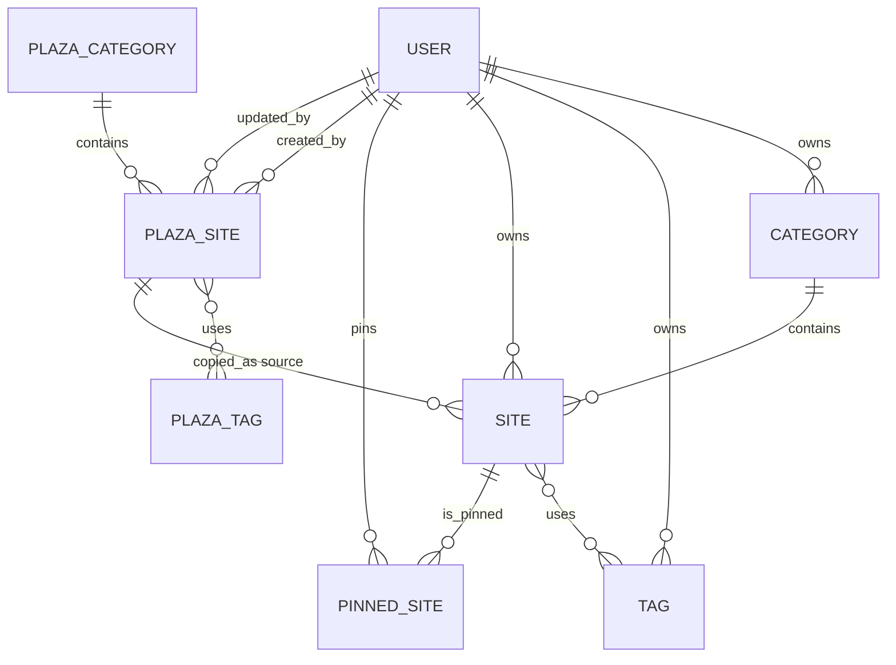

# 后端架构

## 1. 技术选型与入口

后端是 FastAPI + SQLAlchemy 2 + SQLite，使用 Pydantic Settings 配置，JWT（`python-jose`）认证，bcrypt 密码哈希。入口为 `backend/app/main.py`；`backend/run.py` 与 `backend/run.sh` 用于本地启动（默认 `0.0.0.0:9966`）。生产用 systemd 单元 `backend/nav-station-api.service`（服务名 `nav-station-api`）托管 uvicorn，监听 `127.0.0.1:9966`，由 Nginx 同源反代。

路由采用 thin router 模式：认证、导航、置顶与广场业务逻辑位于 `app/routers/`；Agnes AI 解析与目标页面摘要抓取位于 `app/services/ai_suggest.py`。

## 2. 目录

```text
backend/
├── run.py
├── run.sh
├── nav-station-api.service
├── alembic.ini
├── alembic/env.py
├── alembic/versions/0001_initial.py
├── alembic/versions/0002_plaza.py
└── app/
    ├── main.py
    ├── config.py
    ├── database.py
    ├── security.py
    ├── seed.py
    ├── migrate_to_plaza.py
    ├── models/entities.py
    ├── services/ai_suggest.py
    └── routers/{auth,nav,pins,plaza}.py
```

`main.py` 启动时执行 `Base.metadata.create_all(engine)`；迁移目录同时保留 Alembic（含 `0002_plaza`），因此当前是 `create_all` 与 Alembic 并存的双轨方案。空库可用 `create_all`；已有库需跑 Alembic 以增加广场表与 `sites.source_plaza_site_id`。

## 3. 数据模型



| 表 | 关键字段与约束 |
|---|---|
| `users` | `username` 唯一、`password_hash`、`created_at` |
| `categories` | `user_id`、`slug`、`name`、`sort_order`；用户内 `slug` 唯一 |
| `tags` | `user_id`、`name`；用户内 `name` 唯一 |
| `sites` | `user_id`、可空 `category_id`、可空 `source_plaza_site_id`、`slug`、`name`、`url`、`desc`、`detail`、`default_pinned`、`sort_order`；用户内 `slug` 唯一；`(user_id, source_plaza_site_id)` 在来源非空时部分唯一 |
| `site_tags` | `site_id` + `tag_id` 联合主键，多对多关联 |
| `user_pinned_sites` | `user_id` + `site_id` 联合主键，用户置顶关联 |
| `plaza_categories` | 全局 `slug` 唯一、`name`、`sort_order`、`created_at` |
| `plaza_tags` | 全局 `name` 唯一 |
| `plaza_sites` | 全局 `slug` / `url` 唯一、`name`、`desc`、`detail`、可空 `category_id`、`status`（`published` \| `archived`）、`created_by` / `updated_by`（`ON DELETE SET NULL`）、时间戳 |
| `plaza_site_tags` | `plaza_site_id` + `plaza_tag_id` 联合主键，CASCADE |

个人目录查询与变更仍按 `user_id` 限定。广场表全局共享（wiki 协作：任意登录用户可增改与软下架）。`slug` 是前端使用的稳定站点/分类标识，数据库自增 `id` 不直接暴露。从广场导入个人目录时按名称匹配或创建个人分类/标签，并写入 `source_plaza_site_id` 便于追溯与再次同步。

## 4. 路由契约

| 方法 | 路径 | 认证 | 用途 |
|---|---|---|---|
| `GET` | `/health`、`/api/health` | 否 | 返回 `{"status":"ok"}`；后者用于 Nginx/Vite 同源代理检查 |
| `POST` | `/api/auth/login` | 否 | 用户名密码登录，返回 `access_token`、`token_type`、`username` |
| `GET` | `/api/auth/me` | 是 | 返回当前用户名 |
| `GET` | `/api/auth/accounts` | 是 | 返回其他账户用户名 |
| `GET` | `/api/nav` | 是 | 返回当前用户的 categories、tags、sites |
| `POST` | `/api/nav/sites` | 是 | 「我的」新建个人站点；body `{name,url,desc?,detail?,category?,tags?,publish_to_plaza?}`；`publish_to_plaza=true` 时按 URL 幂等同步广场（已有同 URL 广场条目则关联，否则创建）并写入 `source_plaza_site_id`，当前用户已导入同源时返回 409；分类/标签按用户 get-or-create |
| `POST` | `/api/nav/sites/{site_slug}/sync-from-plaza` | 是 | 用已关联的广场最新字段覆盖个人副本（不改分类/排序/置顶） |
| `GET` | `/api/pins` | 是 | 返回 `site_ids`；首次访问时导入默认置顶 |
| `PUT` | `/api/pins` | 是 | 用 slug 数组整体替换置顶集合 |
| `POST` | `/api/pins/{site_id}/toggle` | 是 | 切换一个站点的置顶状态 |
| `GET` | `/api/plaza` | 是 | 广场列表；查询参数 `q` / `category` / `tag` / `include_archived` |
| `GET` | `/api/plaza/meta` | 是 | 仅返回全局 categories、tags |
| `GET` | `/api/plaza/{slug}` | 是 | 广场站点详情 |
| `POST` | `/api/plaza/ai-suggest` | 是 | body `{url}`；调用 Agnes 生成待审阅的站点字段 |
| `POST` | `/api/plaza` | 是 | 创建广场站点；分类/标签随站点 upsert |
| `PUT` | `/api/plaza/{slug}` | 是 | wiki 式全量更新 |
| `POST` | `/api/plaza/{slug}/archive` | 是 | 软下架 |
| `POST` | `/api/plaza/{slug}/restore` | 是 | 恢复发布 |
| `POST` | `/api/plaza/{slug}/add` | 是 | 复制到当前用户个人目录；可选 body `category` |

`/api/nav` 的站点响应字段为 `id`、`name`、`url`、`desc`、`detail`、`category`、`tags`、`pinned`、`source_plaza_id`（可空，广场来源 slug）。广场列表每条含 `added`（当前用户是否已导入）。认证依赖位于 `routers/auth.py` 的 `current_user`，所有受保护路由复用它。

## 5. 认证与安全

登录成功后签发 Bearer JWT，token subject 为用户名，过期时间由 `jwt_expire_minutes` 控制。`OAuth2PasswordBearer` 从 `Authorization` 头读取 token，`decode_username()` 校验后查询用户。密码使用 bcrypt 哈希；无效凭证返回 401。前端保存 token 于 `nav_token`，不是后端 session。广场增改与导入均需登录；`url` 规范化后查重，冲突返回 409。

## 6. 配置

`app/config.py` 从 `.env` 读取以下变量，环境变量名为字段名的大写形式：

| 变量 | 默认值 | 作用 |
|---|---|---|
| `DATABASE_URL` | `sqlite:///./nav_station.db` | SQLAlchemy 数据库 URL |
| `JWT_SECRET` | `change-this-secret-in-production` | JWT 签名密钥，生产必须覆盖 |
| `JWT_EXPIRE_MINUTES` | `10080` | token 有效期 |
| `CORS_ORIGINS` | 生产域名与本地开发地址 | 逗号分隔的允许来源 |
| `AGNES_API_KEY` | 空 | Agnes API Key，仅存后端 `.env` |
| `AGNES_BASE_URL` | `https://api.agnes-ai.cn/v1` | Agnes 国内站 OpenAI 兼容接口基址；国内站 Key 必须使用国内站地址 |
| `AGNES_MODEL` | `agnes-2.5-flash` | 解析使用的模型 |

## 7. Seed 与数据库初始化

运行 `python -m app.seed`（或按 `backend/README.md` 的启动流程）会创建表，确保存在空个人目录用户 `yzjiang` / `test`（默认密码 `123456`），并把 `src/data/sites.json` **写入广场**（广场已有数据则跳过）。不再把 JSON 灌入个人 `sites`。

已有库若要把历史个人站点迁入广场并清空两用户个人目录，运行一次性脚本：`python -m app.migrate_to_plaza`（先清空广场再从 `yzjiang` 复制；重复 URL 会跳过）。

seed 的根目录由 `seed.py` 从 `backend/app` 向上解析到项目根目录，因此部署时必须保留 `src/data` 路径或调整 seed 输入。
