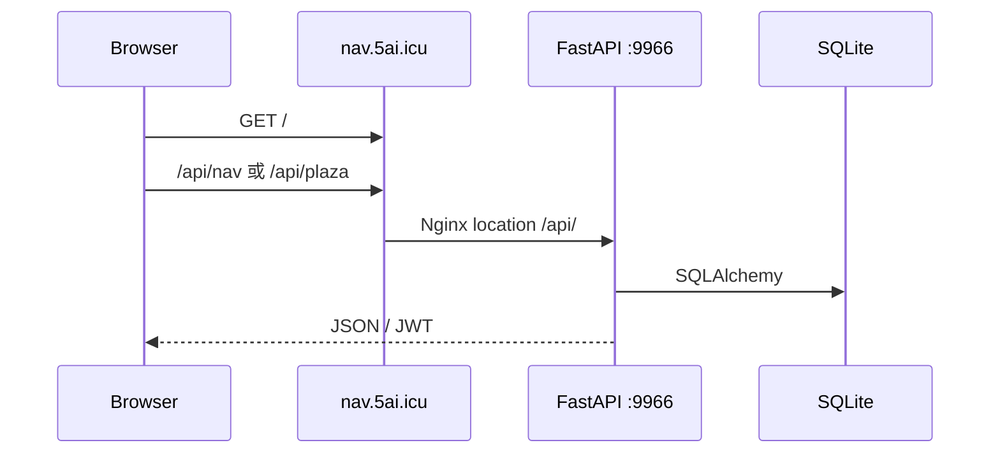

# 全栈架构概览

## 系统边界

Nav Station 是 Vue 3 SPA 与 FastAPI API 的前后端分离导航站：个人网址目录按用户隔离，并提供全局共享的「广场」供多人协作维护实用网站，用户可将广场条目复制到自己的目录。生产环境前端部署于 `https://nav.5ai.icu`，API **默认同源** 请求 `https://nav.5ai.icu/api/...`（Nginx 反代到 FastAPI）；独立域名 `nav-api.5ai.icu` 仅作备选排查，浏览器侧不稳定故不作为默认入口。业务数据属于 SQLite，前端 localStorage 只保存认证缓存和主题偏好。

## 开发与生产

| 环境 | SPA | API |
|---|---|---|
| 开发 | Vite `5173` | 默认同源 `/api`，Vite proxy → `127.0.0.1:9966` |
| 生产 | Nginx 静态 `dist/`，见 `nginx/nav.5ai.icu.conf`（HTTP/1.1；同机 `:443` 不宜混开 HTTP/2） | 默认同源 `https://nav.5ai.icu/api` → systemd `nav-station-api` → `127.0.0.1:9966` |

完整接口表见 [API.md](../API.md)。后端入口是 `backend/app/main.py`；本地 `run.py` 默认可监听 `0.0.0.0:9966`，生产由 `nav-station-api.service` 监听本机环回。前端构建产物由 Nginx 提供，FastAPI 不负责 SPA 静态文件。

## 认证流

1. 登录视图向 `POST /api/auth/login` 发送用户名和密码。
2. API 返回 Bearer JWT；前端写入 `nav_token`，用户名缓存到 `nav_user`。
3. `src/api/client.js` 为每个请求附加 `Authorization: Bearer <token>`。
4. API 通过 `current_user` 解码 JWT 并按用户查询数据。
5. 401 会清理前端认证缓存并回到登录状态。

## API 总览

| 方法 | 路径 | 数据归属 | 说明 |
|---|---|---|---|
| `GET` | `/health`、`/api/health` | 全局 | 健康检查；同源部署检查使用 `/api/health` |
| `POST` | `/api/auth/login` | 登录用户 | 签发 JWT |
| `GET` | `/api/auth/me` | 当前用户 | 验证 token |
| `GET` | `/api/auth/accounts` | 当前用户 | 账户切换列表 |
| `GET` | `/api/nav` | 当前用户 | 完整导航数据（含可选 `source_plaza_id`） |
| `POST` | `/api/nav/sites/{site_slug}/sync-from-plaza` | 当前用户 | 从广场来源重新同步个人副本 |
| `GET` | `/api/pins` | 当前用户 | 置顶 slug 列表 |
| `PUT` | `/api/pins` | 当前用户 | 替换置顶集合 |
| `POST` | `/api/pins/{site_id}/toggle` | 当前用户 | 切换站点置顶 |
| `GET` | `/api/plaza` | 全局广场 | 列表与筛选 |
| `GET` | `/api/plaza/meta` | 全局广场 | 分类与标签元数据 |
| `GET` | `/api/plaza/{slug}` | 全局广场 | 详情 |
| `POST` | `/api/plaza/ai-suggest` | 当前用户 | 根据网址调用 Agnes 生成待审阅字段 |
| `POST` | `/api/plaza` | 全局广场 | 创建 |
| `PUT` | `/api/plaza/{slug}` | 全局广场 | wiki 更新 |
| `POST` | `/api/plaza/{slug}/archive` | 全局广场 | 软下架 |
| `POST` | `/api/plaza/{slug}/restore` | 全局广场 | 恢复 |
| `POST` | `/api/plaza/{slug}/add` | 当前用户 | 复制到个人目录 |

详细请求响应和实现见 [frontend.md](frontend.md)、[backend.md](backend.md) 与 [API.md](../API.md)。

## 数据归属

- SQLite 个人域：`users`、`categories`、`tags`、`sites`、`site_tags`、`user_pinned_sites`。
- SQLite 广场域：`plaza_categories`、`plaza_tags`、`plaza_sites`、`plaza_site_tags`；个人 `sites.source_plaza_site_id` 追溯导入来源。
- `nav_token`：浏览器认证缓存，不是业务数据。
- `nav_user`：浏览器中的用户名显示缓存。
- `nav_theme`：浏览器主题偏好。
- `src/data/sites.json`：seed 输入，写入广场；不是运行时前端业务数据源。

跨栈契约变化必须同时检查 API client、对应 composable、路由实现和本页 API 表。
